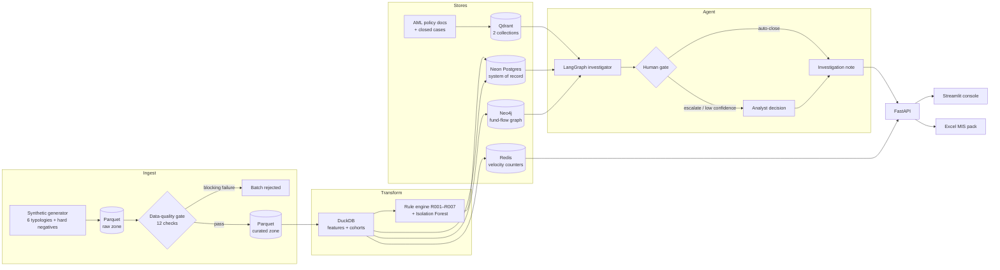

# Sentinel AML Copilot

**An agentic AI copilot that investigates anti-money-laundering alerts end to end** — it traces
money-mule networks across a graph, grounds every conclusion in bank policy, and produces an
auditable investigation note for a human analyst to sign off.

> **Build status:** architecture and design complete; implementation in progress. Commands in
> [Getting started](#getting-started) describe the target interface and are being wired up
> module by module. This line disappears when the pipeline runs end to end.

---

## The problem

A bank's **transaction monitoring system** (TMS — the rules engine that watches every payment)
fires thousands of alerts a day. Two things go wrong:

1. **Analysts drown in false positives.** Industry reporting puts false-positive rates on
   rule-based AML alerts above 90%, at roughly 20–30 minutes of manual work each — pull the
   transaction history, check the counterparties, read the relevant policy, write the note.
2. **Account-level rules cannot see networks.** A **money mule** is an account opened by a real
   person but operated by fraudsters to hop stolen funds onward. Any single mule account looks
   unremarkable. The fraud only exists as a *structure* — many small credits fanning in, a chain
   of onward hops, funds eventually returning to where they started. A rule engine that scores one
   account at a time is structurally blind to this. You need to traverse relationships, not filter
   rows.

That second point is the reason this project exists, and the reason it uses a graph database
rather than reaching for one because graphs are fashionable.

## What it does

| Capability | How |
|---|---|
| Detects candidate suspicious activity | Deterministic rule engine (TMS stand-in) + Isolation Forest anomaly model |
| Sees the network, not the account | Neo4j fund-flow graph — multi-hop tracing, cycle detection, fan-in/fan-out, shared-device rings |
| Grounds conclusions in policy | Vector search (Qdrant) over an AML typology handbook and internal policy |
| Learns from precedent | Vector search over narratives and outcomes of previously closed cases |
| Investigates autonomously | LangGraph agent: plans → calls up to 6 tools → scores → reasons → escalates or closes |
| Never decides alone | Human-in-the-loop gate; the agent's recommendation and the human's decision are stored separately |
| Produces the paperwork | A cited investigation note, an Excel MIS pack, and a Streamlit console |
| Answers in real time | `POST /v1/score` reads pre-computed velocity counters from Redis — no LLM on this path |

## Architecture



**Layering.** The code follows ports-and-adapters (clean architecture): `domain` depends on
nothing external, `application` depends only on `domain`, and `infrastructure` implements
`domain`-defined `Protocol` ports. `api`, `ui`, and `agent` sit on top. This is what makes the
Redis→Aerospike swap a one-file change rather than a refactor.

## Technology choices

Every row answers *"why this?"* — the point of the project is thoughtful engineering, not a long
technology list.

| Layer | Choice | Why this one |
|---|---|---|
| Language | **Python 3.12** | Correct for the data + agent stack; type hints throughout, `mypy --strict` |
| Warehouse | **Neon Postgres** (serverless) | System of record. Branchable, scales to zero, generous free tier |
| Analytics engine | **DuckDB** | In-process OLAP over Parquet — columnar speed with no server to run |
| Lakehouse storage | **Parquet**, medallion layout | Same pattern as an S3 data lake; the migration is a path string |
| Graph | **Neo4j AuraDB** | Unbounded-hop traversal (`-[:TRANSFERRED*1..4]->`). There is no clean SQL equivalent — this is the load-bearing justification, not decoration |
| Vector | **Qdrant Cloud** | Policy grounding and case precedent. Rust-based, and its payload filtering lets one query combine metadata filters with vector similarity |
| Embeddings | **fastembed** (`BAAI/bge-small-en-v1.5`) | Runs locally via ONNX — no API cost, no PyTorch download, 384 dimensions |
| Feature store | **Redis** behind a `FeatureStore` port | Sub-millisecond counter reads for the real-time endpoint |
| Agent framework | **LangGraph** | An explicit, checkpointed state machine — auditable and replayable, which is what a regulated institution actually needs from an AI system |
| LLM | **DeepSeek** via OpenRouter | ~$0.05 per investigation; the whole project fits under a $2 budget |
| API | **FastAPI** + Pydantic v2 | Async, typed, self-documenting |
| UI | **Streamlit** | Fastest credible analyst console |
| Reporting | **openpyxl** | Business consumers want Excel, so the pipeline emits Excel |
| Orchestration / CI | **GitHub Actions** | The answer to "what orchestrates this?" — an honest cron-plus-secrets stand-in for Airflow, not a claim to be one |
| ML | **scikit-learn** Isolation Forest | Unsupervised is the correct choice: fraud labels are scarce, arrive months late, and are severely imbalanced |

### Three design decisions worth calling out

**The LLM never computes and never routes.** Risk scores come from a fixed weighted formula in
Python. Graph facts come from Cypher. Routing between agent nodes is code. The language model
plans which tools to call and writes the narrative — nothing else. A model that silently
recalculates a risk score is unauditable, and an unauditable AML system is unusable.

**The human gate is structural, not advisory.** An investigation escalates to a human whenever
confidence is below threshold, the risk score is high, the recommendation is *escalate*, the
amount at risk crosses ₹10 lakh, or any tool errored. This is enforced by a LangGraph `interrupt`
— the graph physically cannot proceed to close, rather than being asked politely not to.

**Retrieved text is data, never instructions.** Policy chunks and past-case narratives enter the
prompt inside a fenced block with an explicit boundary statement. All six agent tools are
read-only. A vector store that anyone can write to is a prompt-injection surface.

## Detection layer

**Six mule typologies** are injected into the synthetic population: fan-in/fan-out, layering
chains, circular round-tripping, structuring below the reporting threshold, dormant-account
reactivation, and device-shared rings.

**Four hard negatives** are injected deliberately so the classes overlap and precision cannot
trivially reach 1.0: a small merchant with genuinely high fan-in, salary-day fan-out, family
expense pooling, and a genuine dormant-account return.

Ground truth lives in a `typology_labels` table that **only the metrics module and the tests may
read** — a lint rule is designed to enforce it once CI exists; today the boundary is held by
convention and a test. Precision and recall are measured against it and reported as measured,
whatever the numbers turn out to be.

## Getting started

Requires **Python 3.12+**.

```bash
git clone <this-repo> && cd sentinel-aml-copilot
python -m venv .venv
.venv\Scripts\activate          # Windows  (source .venv/bin/activate elsewhere)
pip install -e ".[dev]"
cp .env.example .env            # then fill in your keys
```

`.env.example` documents every required key, including which console screen each one comes from.
Nothing sensitive is committed; secrets live in `.env` locally and in GitHub Actions Secrets for CI.

| Command | What it does |
|---|---|
| `make doctor` | Ping every store and verify the LLM model slugs — run this first |
| `make generate` | Synthesise the population and land 205,419 transactions in the raw zone |
| `make quality` | Run the 12-check data-quality gate — exits 1 if a BLOCKING check fails |
| `make pipeline` | Generate data → validate → load Postgres, Neo4j, Qdrant, Redis (idempotent). **Not wired yet** — `pipeline/run.py` does not exist, so this target fails today. Run `generate` and `quality` individually |
| `make api` | Run the FastAPI service |
| `make ui` | Run the Streamlit investigator console |
| `make test` | Unit tests — no network, no LLM tokens |
| `make eval` | Agent eval harness against the golden alert set (**costs tokens**) |
| `make check` | `ruff` + `mypy --strict` + 370 unit tests — the intended CI gate (no workflow file exists yet) |

`make help` lists all 20 targets. On Windows, GNU Make is typically installed as `mingw32-make`,
so substitute that for `make` (e.g. `mingw32-make check`).

Every load is designed to be idempotent: Postgres uses `INSERT … ON CONFLICT DO UPDATE`, Neo4j uses
`MERGE`, and Qdrant point IDs are deterministic UUID5 hashes, so re-running the pipeline is always
safe. None of the four loaders is written yet — `generate` and `quality` are the two stages that run
today.

## Honest limitations

Stated up front, because a portfolio project that pretends to be production is worse than one that
knows the difference.

1. **The synthetic data is partly circular** — we inject typologies and then detect them.
   Mitigated by generating patterns in a module that withholds ground truth, and by the hard
   negatives above.
2. **We generate our own alerts and then triage them.** The rule engine is an explicit stand-in
   for a vendor TMS (Actimize, SAS, Oracle Mantas). The agent's input interface is shaped so a
   real alert feed drops in unchanged.
3. **Scale is three to four orders of magnitude below production** — roughly 200k transactions,
   not billions.
4. **Latency figures are local measurements, not benchmarks**, and are always reported as
   "p50/p99 over N local requests, single node, no contention".
5. **Graph algorithms are hand-written Cypher plus `networkx`**, because Neo4j's Graph Data
   Science library is not assumed available on the free tier.
6. **No real governance environment.** PII masking and an audit trail exist; access control and
   segregation of duties do not.
7. **Not a statutory filing.** The output is an internal investigation note, not an FIU-IND STR.

## Roadmap

- **Aerospike as the feature store.** Already designed in behind the `FeatureStore` port; Redis
  implements it today. Aerospike's server is Linux-only and Docker is unavailable on the build
  machine, so this is a documented platform constraint rather than an oversight — the swap is one
  new adapter file.
- **AWS deployment** — S3 raw zone, EC2, IAM. The component-by-component mapping is written; local
  Parquet stands in for S3 and the change is a path prefix.
- **Streaming ingestion** (Kafka or database CDC) in place of batch.
- **dbt** for transformation modelling and lineage.
- **Real graph algorithms** via Neo4j GDS — Louvain community detection instead of `networkx`.

## Data privacy

All data in this repository is **synthetic**, generated by the pipeline. No real customer data is
used at any point. PAN-style identifiers are stored only as salted SHA-256 hashes, never in
plaintext, and phone numbers, account identifiers, and credentials are never written to logs.

## License

MIT
